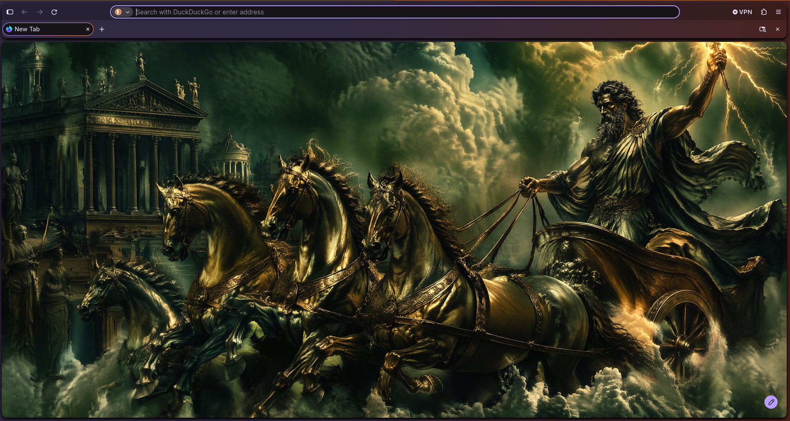
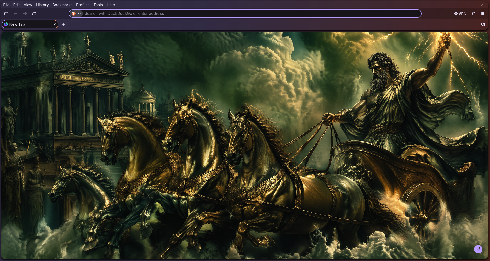
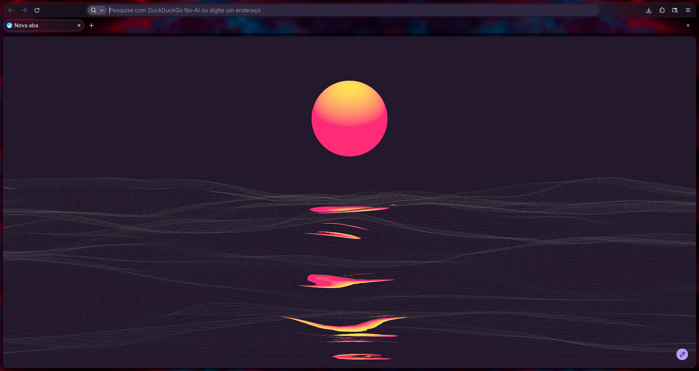
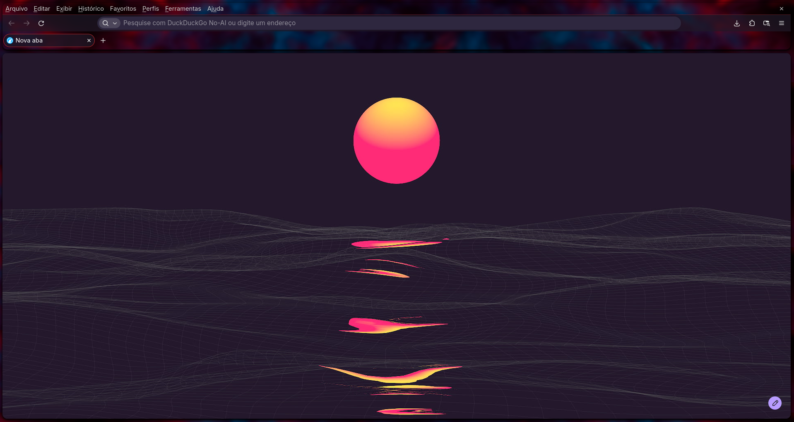
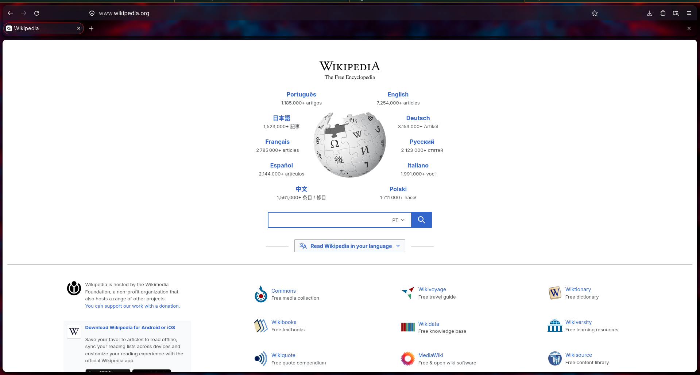

###  <h1 align="center">Firefox Custom CSS 🎨</h1>

## PT-BR | ENG | ES

# PT-BR
Uma personalização visual para o Firefox, criada para deixar o navegador mais bonito, moderno e agradável de usar.

O visual padrão do Firefox pode acabar sendo um pouco simples e sem personalidade. Este projeto busca mudar isso com um CSS alternativo que traz cantos arredondados, um topo mais elegante e uma aparência mais limpa para as páginas e elementos do navegador.

Características:
Interface mais moderna e minimalista.
Barra superior com cantos arredondados.
Páginas e elementos com bordas arredondadas.
Visual mais limpo e harmonioso.
Personalização feita inteiramente em CSS.

Como instalar:
Abra o Firefox e digite about:config na barra de endereço.
Procure pela opção toolkit.legacyUserProfileCustomizations.stylesheets.
Altere o valor para true.
Acesse about:support e localize a pasta Diretório do perfil.
Abra a pasta do perfil e crie uma pasta chamada chrome, caso ainda não exista.
Coloque os arquivos CSS deste projeto dentro da pasta chrome.
Reinicie o Firefox.

Pronto! Seu Firefox estará com uma aparência renovada.
Veja abaixo algumas imagens mostrando o visual e as personalizações do projeto.

Observações:
Recomendado utilizar a versão mais recente do Firefox.
O visual pode variar dependendo da versão do navegador.
Caso queira personalizar ainda mais, fique à vontade para modificar os arquivos CSS.

Feito com ❤️ no planeta terra para deixar o Firefox mais bonito.

#  English 

Firefox Custom CSS 🎨

A visual customization for Firefox, designed to make the browser look more beautiful, modern, and enjoyable to use.

Firefox's default appearance can sometimes feel a little too simple and lack personality. This project aims to change that with alternative CSS that introduces rounded corners, a more elegant top bar, and a cleaner look for pages and browser elements.

Features:
A more modern and minimalist interface.
Rounded corners on the top bar.
Rounded edges on pages and interface elements.
A cleaner and more harmonious appearance.
Entirely CSS-based customization.
Installation:
Open Firefox and type about:config in the address bar.
Search for toolkit.legacyUserProfileCustomizations.stylesheets.
Set its value to true.
Visit about:support and locate the Profile Folder.
Open the profile folder and create a folder named chrome, if it does not already exist.
Place this project's CSS files inside the chrome folder.
Restart Firefox.

That's it! Your Firefox will now have a refreshed look.

Take a look at the screenshots below to see the design and customizations.

Notes:
Using the latest version of Firefox is recommended.
The appearance may vary depending on your browser version.
Feel free to modify the CSS files to further customize your experience.

Made with ❤️ on planet Earth to make Firefox look better.

#  Español

Firefox Custom CSS 🎨

Una personalización visual para Firefox, diseñada para hacer que el navegador sea más bonito, moderno y agradable de usar.

El aspecto predeterminado de Firefox puede resultar un poco simple y carecer de personalidad. Este proyecto busca cambiar eso mediante CSS alternativo que incorpora esquinas redondeadas, una barra superior más elegante y una apariencia más limpia para las páginas y los elementos del navegador.

Características:
Una interfaz más moderna y minimalista.
Barra superior con esquinas redondeadas.
Bordes redondeados en páginas y elementos de la interfaz.
Una apariencia más limpia y armoniosa.
Personalización realizada íntegramente con CSS.
Instalación:
Abre Firefox y escribe about:config en la barra de direcciones.
Busca la opción toolkit.legacyUserProfileCustomizations.stylesheets.
Cambia su valor a true.
Accede a about:support y localiza la Carpeta del perfil.
Abre la carpeta del perfil y crea una carpeta llamada chrome, si todavía no existe.
Coloca los archivos CSS de este proyecto dentro de la carpeta chrome.
Reinicia Firefox.

¡Listo! Tu Firefox tendrá un aspecto renovado.

A continuación, puedes ver algunas capturas de pantalla que muestran el diseño y las personalizaciones del proyecto.

Notas:
Se recomienda utilizar la versión más reciente de Firefox.
La apariencia puede variar según la versión del navegador.
Si deseas personalizarlo aún más, puedes modificar libremente los archivos CSS.

Hecho con ❤️ en el planeta Tierra para hacer que Firefox se vea mejor.

